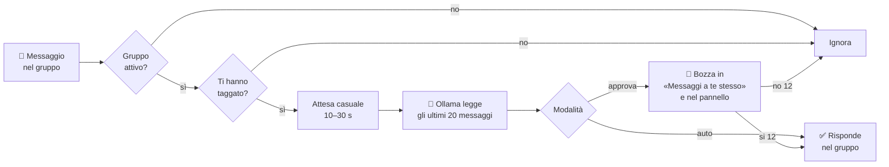

# 🤖 WhatsApp Bot Gruppi

**Un assistente per le chat di gruppo WhatsApp, con AI locale e gratuita.**
Per ogni gruppo scegli se rispondere da solo, preparare bozze da approvare o avvisare che risponderai più tardi. Gira sul tuo PC Windows o in un container Proxmox.


> [!WARNING]
> Questo progetto **non è ufficiale** e non ha legami con WhatsApp o Meta. Automatizza WhatsApp Web, cosa che i [Termini di servizio di WhatsApp](https://www.whatsapp.com/legal/terms-of-service) non consentono: **il numero collegato può essere bloccato**. Usalo a tuo rischio, meglio con una SIM dedicata, e avvisa i membri dei gruppi che a volte risponde un assistente automatico.

---

## ✨ Cosa fa

| Funzione | Descrizione |
|---|---|
| 🎛️ **Regole per gruppo** | Ogni gruppo ha la sua modalità, le sue istruzioni e il suo tono |
| 💬 **Risposte automatiche** (`auto`) | L'AI legge gli ultimi messaggi e risponde a tuo nome, mostrando prima "sta scrivendo…" |
| 📝 **Bozze da approvare** (`approva`) | La risposta non parte finché non la approvi, dal pannello web o dal telefono |
| 🤖 **Avviso "Assistente IA"** | Se ti scrivono e non rispondi, avvisa che risponderai appena puoi |
| 🏠 **AI gratuita e locale** | Usa [Ollama](https://ollama.com): i messaggi non escono da casa tua. In alternativa c'è il piano gratuito di Gemini |
| 🛡️ **Comportamento "umano"** | Pause casuali, una sola risposta per raffica di messaggi, limite di risposte all'ora |
| 🖥️ **Pannello web** | Bozze, stato del collegamento e QR code, protetti da password |
| 🔁 **Configurazione a caldo** | Le modifiche a `gruppi.json` valgono subito, senza riavviare |

## 🔍 Come funziona



Il bot si collega a WhatsApp come **dispositivo collegato**, come WhatsApp Web, tramite la libreria [whatsapp-web.js](https://github.com/pedroslopez/whatsapp-web.js). Il telefono resta il dispositivo principale.

## 🚀 Avvio rapido

### Windows

1. Installa [Node.js](https://nodejs.org) (18 o superiore) e [Ollama](https://ollama.com).
2. Scarica il modello: `ollama pull gemma4:e4b`
3. Scarica questo repository e fai doppio clic su **`avvia.bat`**.
4. Telefono → WhatsApp → **Dispositivi collegati** → inquadra il QR code (anche dal pannello <http://localhost:3001>).

### Proxmox (container LXC)

```bash
# nella console del container (Debian 12/13 o Ubuntu 24.04)
apt update && apt install -y git
git clone https://github.com/<utente>/whatsapp-bot-gruppi.git   # indirizzo dal pulsante verde «Code»
cd whatsapp-bot-gruppi

# con un Ollama che hai già in rete...
bash installa-proxmox.sh --ollama http://IP-DI-OLLAMA:11434 qwen3.5:4b
# ...oppure installando Ollama nello stesso container
bash installa-proxmox.sh
```

Lo script installa tutto, crea il servizio con avvio automatico e alla fine mostra indirizzo e password del pannello.
Tutti i passaggi sono in [docs/PROXMOX.md](docs/PROXMOX.md).

## ⚙️ Configurazione

Al primo collegamento il bot elenca tutti i tuoi gruppi in `gruppi.json`, **tutti spenti**. Per accenderne uno:

```json
"120363012345678901@g.us": {
  "nome": "Circolo del tennis",
  "modalita": "approva",
  "quando": "menzione",
  "istruzioni": "È il gruppo del circolo. Gli allenamenti sono il martedì e il giovedì alle 19.",
  "maxOra": 5,
  "assenza": { "attivo": true, "dopoMessaggi": 2, "dopoMinuti": 5 }
}
```

| Campo | Valori | Significato |
|---|---|---|
| `modalita` | `off` · `auto` · `approva` | Cosa fa il bot nel gruppo |
| `quando` | `menzione` · `parole` · `sempre` | Quando intervenire: se ti taggano o rispondono a te, se compare una delle `parole`, oppure sempre (l'AI decide se serve) |
| `istruzioni` | testo | Cosa deve sapere l'AI su quel gruppo e con che tono rispondere |
| `maxOra` | numero | Massimo di risposte o bozze all'ora |
| `assenza` | oggetto | Avviso "Assistente IA" quando non rispondi (funziona anche con `modalita: off`) |

Le impostazioni generali (modello AI, nome, stile, pause, porta e password del pannello) sono in `config.json`. La guida completa è in [docs/GUIDA.md](docs/GUIDA.md).

### Approvare le bozze dal telefono

Le bozze arrivano nella chat **«Messaggi a te stesso»**. Rispondi lì:

| Comando | Effetto |
|---|---|
| `si 12` | invia la bozza 12 così com'è |
| `no 12` | la scarta |
| `mod 12 testo nuovo` | invia il tuo testo al posto della proposta |

## 🧠 Modelli AI

| Opzione | Costo | Privacy | Note |
|---|---|---|---|
| **Ollama** (consigliato) | Gratis | ✅ tutto in locale | Servono circa 6–8 GB di RAM per un modello da 4B. Ad esempio `gemma4:e4b` o `qwen3.5:4b` |
| **Gemini**, piano gratuito | Gratis, con limiti giornalieri | ⚠️ Google può usare i testi inviati | Imposta `"ai": "gemini"` e una chiave da [AI Studio](https://aistudio.google.com) |

Il ragionamento esteso dei modelli che lo prevedono (Qwen3 e simili) viene disattivato in automatico, così le risposte sono più rapide.

## 📁 Struttura

```
├── bot.js                # collegamento a WhatsApp, logica delle risposte, pannello web
├── assenza.js            # avviso "Assistente IA" quando non rispondi
├── pannello.html         # pannello bozze (http://IP:3001)
├── config.json           # impostazioni generali
├── gruppi.json           # regole per ogni gruppo (si compila da solo)
├── avvia.bat             # avvio su Windows
├── installa-proxmox.sh   # installazione su Debian/Ubuntu con servizio systemd
└── docs/
    ├── GUIDA.md          # guida completa
    └── PROXMOX.md        # installazione passo passo su Proxmox
```

## 🛠️ Problemi noti e soluzioni

<details>
<summary><b>In un container Proxmox Chrome non parte ("Timed out… WS endpoint")</b></summary>

Negli LXC Chrome non può aprire la porta interna di debug. Il bot usa già `pipe: true`, cioè comunica con Chrome senza porta di rete.
</details>

<details>
<summary><b>Su Ubuntu 24.04 compare "ERR_INTERNET_DISCONNECTED"</b></summary>

Il profilo AppArmor di Ubuntu per Google Chrome, dentro un container, gli blocca la rete. Lo script d'installazione usa il Chrome scaricato da puppeteer (`npx puppeteer browsers install chrome`), che non subisce quel blocco. Non serve toccare AppArmor.
</details>

<details>
<summary><b>"Ollama non risponde"</b></summary>

Se Ollama gira su un'altra macchina, deve accettare connessioni dalla rete: `systemctl edit ollama`, aggiungi `Environment="OLLAMA_HOST=0.0.0.0:11434"` sotto `[Service]`, poi `systemctl restart ollama`.
</details>

<details>
<summary><b>Il bot non si collega più dopo un aggiornamento di WhatsApp Web</b></summary>

Aggiorna la libreria: `npm update whatsapp-web.js`, poi riavvia il bot.
</details>

## 🔒 Privacy

- Con Ollama i messaggi dei gruppi vengono elaborati **solo sulla tua macchina**.
- La sessione WhatsApp (`.sessione/`), le bozze (`bozze.json`) e la tua configurazione restano in locale e sono esclusi da git tramite `.gitignore`.
- Il pannello ascolta solo su `localhost`, a meno che tu non attivi `accessoDaRete`. In quel caso è protetto da password.

## 📄 Licenza

[MIT](LICENSE). Si basa su [whatsapp-web.js](https://github.com/pedroslopez/whatsapp-web.js) (Apache-2.0), [Ollama](https://ollama.com) ed [Express](https://expressjs.com).
